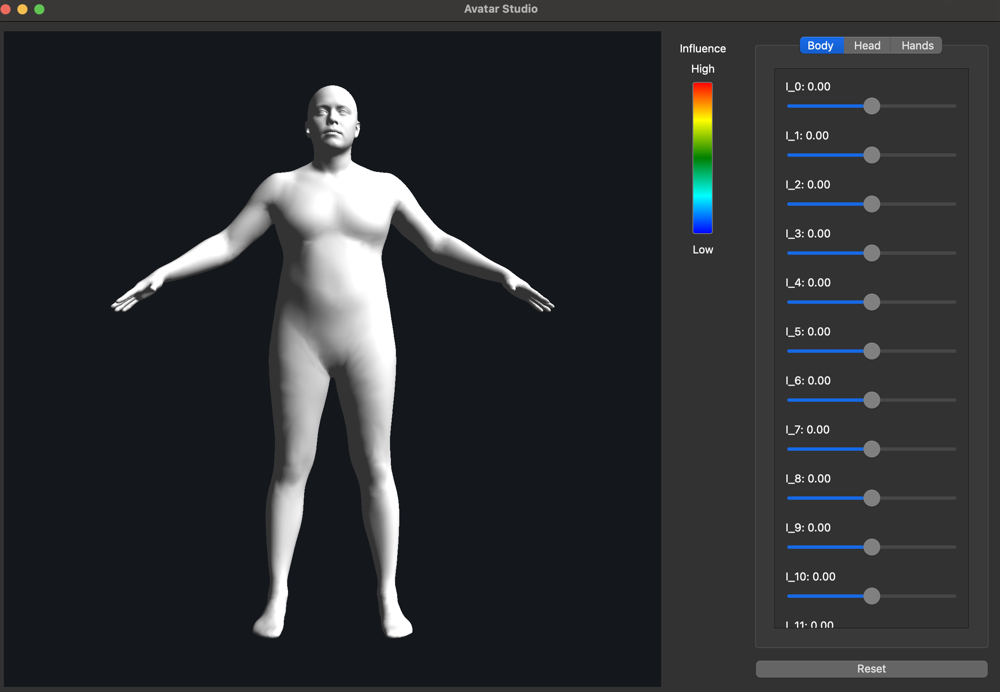

# AvatarStudio

Interactive viewer for exploring the identity (body shape) parameters of
[MHR](https://github.com/facebookresearch/MHR), Meta's Momentum Human Rig.

The project has two parts:

- **C++ / Qt viewer** — renders the MHR mesh with OpenGL and exposes each
  identity parameter as a slider. Hovering a slider shows a heatmap of which
  vertices that parameter influences.
- **Python fitting** — scripts that export MHR data for the viewer, analyse
  the identity parameters, and prototype fitting MHR to user-given body
  measurements (bust, waist, hips).

> Work in progress.



## Repository layout

```
AvatarStudio/
├── CMakeLists.txt        # Qt viewer build
├── src/                  # C++ viewer sources
├── models/               # Mesh data generated from MHR, loaded by the viewer
└── python-fitting/
    ├── export/           # Export MHR data to models/ (.bin, .obj)
    ├── measurements/     # Circumference measurement + fitting prototype
    ├── analysis/         # Parameter / measurement analysis
    └── visualization/    # Matplotlib visualisations of identity parameters
```

## C++ viewer

### Features

- 45 identity parameters as sliders, grouped into Body (0–19),
  Head (20–39) and Hands (40–44) tabs
- Live mesh deformation from the MHR identity basis
- Influence heatmap on slider hover
- Camera with orbit, pan and zoom (mouse + wheel); Reset button

### Requirements

- Qt 6 (Widgets, OpenGLWidgets)
- CMake ≥ 3.21
- C++17 compiler

### Build

Open `CMakeLists.txt` in Qt Creator, or:

```bash
cmake -S . -B build -DCMAKE_PREFIX_PATH=/path/to/Qt/6.x/macos
cmake --build build
```

**Note:** model paths are currently hardcoded as `../../models/...`, relative
to the working directory. Run the app from a directory two levels below the
project root (e.g. Qt Creator's default `build/<kit>/`).

### Model data

| File | Used for |
|---|---|
| `models/mhr_identity.bin` | Base vertices, identity basis, faces (main mesh data) |
| `models/mhr_identity0.obj` | Initial mesh / camera framing |
| `models/mhr_identity{0,1,2}_{-2,+2}.obj` | Min/max shapes for the first three parameters (loaded, not yet used) |

`mhr_identity.bin` layout (little-endian):

```
uint32 vertexCount
uint32 parameterCount
uint32 faceCount
float32[vertexCount * 3]                  base vertices
float32[parameterCount * vertexCount * 3] identity basis
int32[faceCount * 3]                      triangle indices
```

## Python fitting

### Setup

The scripts depend on the `mhr` package and its model assets. Clone MHR and
set up its environment following
[its README](https://github.com/facebookresearch/MHR#installation):

```bash
git clone https://github.com/facebookresearch/MHR.git
cd MHR
pixi install
pixi run download-assets
pixi add matplotlib scipy trimesh
```

Then run scripts from inside the MHR environment, e.g.:

```bash
cd MHR
pixi run python ../python-fitting/export/export_mhr_identity.py
```

Scripts write their output to the current directory; copy results into
`models/` manually.

### Scripts

- `export/export_mhr_identity.py` — writes `mhr_identity.bin` (LOD 1,
  first 45 identity parameters)
- `export/export_shapes.py` — exports per-parameter `.obj` meshes
- `measurements/measurement_engine.py` — circumference measurement on the
  MHR mesh
- `measurements/test_mhr_fitting.py` — fitting prototype: estimates a
  measurement Jacobian (waist, bust, hip vs. body parameters) and iteratively
  solves for identity coefficients that hit target measurements

## Credits

Built on [MHR](https://github.com/facebookresearch/MHR) by Meta, licensed
under Apache 2.0. Meshes in `models/` are generated from MHR.
